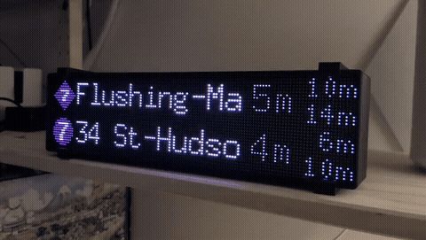

# Matrix Hub

Matrix Hub is a Rust-based, dual-core embedded application designed for the ESP32 (using ESP-IDF) to drive a HUB75 LED matrix display. It acts as a smart display hub featuring various built-in apps, web-based configuration, and hardware gesture controls.




## Features

- **High-Performance Rendering**: Utilizes ESP32's dual cores. Core 1 is dedicated entirely to high-priority display driving and DMA memory management, ensuring smooth, flicker-free rendering. Core 0 handles application logic, networking, and asynchronous tasks.
- **Built-in Apps**:
  - **MTA**: Real-time subway arrivals and transit information.
  - **Plasma**: A mesmerizing, math-based plasma visualizer.
  - **Particles**: A physics-based particle system.
  - **Settings**: Device information and configuration.
- **Hardware Controls**:
  - **Gesture Support**: Integrated LIS3DH accelerometer for swipe and tilt gesture detection.
  - **Physical Buttons**: Up/Down GPIO buttons for manual navigation.
- **Network & Configuration**:
  - Built-in WiFi management with a Captive Portal for easy network setup.
  - A modern, responsive web frontend built with Preact and Vite for device configuration.
  - Protocol Buffers (protobuf) used for efficient communication.

## Hardware Requirements

- **Microcontroller**: ESP32-S3 with PSRAM (developed on an Adafruit MatrixPortal S3)
- **Display**: 128x32 HUB75 LED Matrix Display
- **Sensors**: LIS3DH Accelerometer (I2C)
- **Input**: Tactile buttons (GPIO)

### Default Pinout

| Component | Pin(s) |
| :--- | :--- |
| **I2C (LIS3DH)** | SDA: GPIO16, SCL: GPIO17 |
| **Buttons** | Up: GPIO6, Down: GPIO7 |

*(Refer to `src/config.rs` for the HUB75 display pin configuration).*

## Software Requirements

- [Rust](https://rustup.rs/) (v1.82+)
- `esp-idf` toolchain (installed via `esp-idf-sys` / `embuild`)
- [Node.js](https://nodejs.org/) & npm (for building the Preact frontend)

## Project Structure

- `core/`: Hardware-independent, host-tested logic (see [Testing](#testing)).
  - `core/src/apps/`: The apps (MTA, Plasma, Particles, Settings) and the `AppManager`.
  - `core/src/apps/mta/`: GTFS-RT feed parsing, routes, and arrival-board rendering.
  - `core/src/buffer.rs`, `input.rs`, `net/`, `device_config.rs`: Framebuffer pool, gesture/debounce logic, DNS replies and HTTP body handling, config validation.
- `src/`: The firmware: hardware glue around `core`.
  - `src/platform.rs`: Safe wrappers around ESP-IDF APIs (the only home of raw FFI).
  - `src/display.rs`: HUB75 driver binding and the display thread.
  - `src/input.rs`: Button and accelerometer drivers.
  - `src/network/`: WiFi manager, captive-portal DNS server, HTTP client and server.
  - `src/mta.rs`: Feed downloads for the MTA app.
  - `src/diag.rs`: Runtime diagnostics (watchdog, breadcrumbs, coredumps, `/api/debug`).
- `frontend/`: Preact/Vite web app for device configuration.
- `proto/`: Protocol Buffer definitions for data exchange.
- `components/`: ESP-IDF native components (e.g., HUB75 wrapper).
- `scripts/`: Host-side tools for monitoring the device and decoding coredumps.
- `partitions.csv`: Flash layout (app, NVS, and a coredump partition).

## Building and Running

1. **Configure**: copy `.env.example` to `.env` and set the default WiFi and setup-AP credentials (compiled in; WiFi can be changed later from the web UI).

2. **Install frontend dependencies** (once): `cd frontend && npm install`. The frontend is built automatically by `build.rs` and embedded in the firmware.

3. **Build and flash** (needs the Rust ESP toolchain, e.g. via `espup`):
   ```bash
   cargo run --release
   ```
   This flashes with `partitions.csv` and opens a serial monitor. On WSL, forward the board's USB port from Windows first with [`usbipd`](https://github.com/dorssel/usbipd-win) (`usbipd attach --wsl --busid <id>`).

## Testing

Hardware-independent logic lives in the `core/` crate (apps, MTA feed parsing and rendering, input interpretation, DNS replies, config validation, the frame pool). It builds for both the ESP32-S3 and your PC, and is tested on the PC with [googletest](https://crates.io/crates/googletest):

```bash
cd core
cargo test
cargo llvm-cov --fail-under-lines 100   # CI requires 100% line coverage
```

The MTA renderer also has golden-image tests (`core/src/apps/mta/render_golden.rs`) that fail if any scenario's pixels change; after an intentional layout change, update the recorded fingerprints (run with `--nocapture` to print them). The firmware crate (`src/`) is the hardware glue around `core`: drivers, WiFi, servers, and diagnostics.

## Diagnostics

The device is built to explain its own failures, since it usually runs unattended:

- **Watchdog recovery**: if the main loop or display thread stops for 10s, or the background fetcher is stuck mid-fetch for 5 minutes, the device panics, saves a coredump to flash, and reboots.
- **`GET /api/debug`**: JSON health snapshot: uptime, reset reason, per-thread progress counters and current stage, heap usage and low-water marks, the FreeRTOS task list, the previous boot's last breadcrumbs, and a summary of any stored coredump.
- **`GET /api/coredump`** downloads the stored coredump; **`DELETE /api/coredump`** clears it.
- **`POST /api/debug/test-hang`** / **`POST /api/debug/test-hang-worker`** deliberately hang the main loop / fetcher to verify the pipeline end to end.

Host tools:

```bash
# Log health every 30s (e.g. overnight); flags stalls and reboots, and downloads
# any coredump alongside the firmware ELF it belongs to
python3 scripts/monitor.py <device-ip> --elf <flashed-firmware.elf>

# Per-task backtraces from a coredump (installs the Xtensa GDB on first use)
scripts/decode-coredump.sh <coredump.bin> <firmware.elf>
```

Keep a copy of the ELF you flash (`target/xtensa-esp32s3-espidf/release/matrix-hub`): a coredump can only be decoded against the exact build that produced it.

## License

This project is licensed under the MIT License - see the [LICENSE](LICENSE) file for details.
